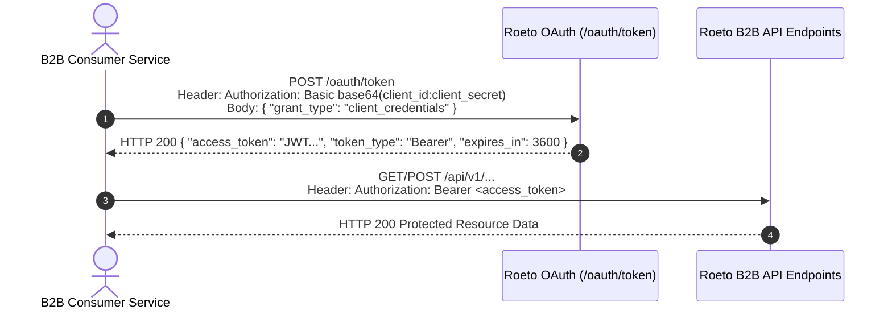
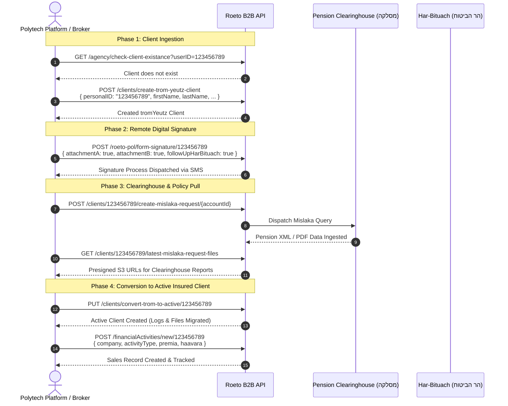
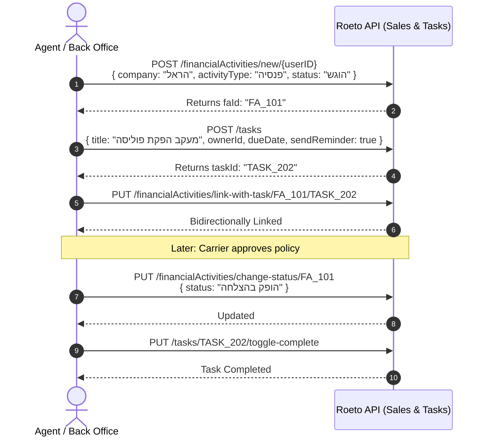

# Roeto B2B API — Complete Documentation & Reference

> **API Server**: `https://api.roeto.co.il/api/v1`  
> **API Version**: `1.0.0` (OpenAPI 3.0.0 Specification)  
> **Official Interactive Swagger UI**: [https://api.roeto.co.il/api-docs/](https://api.roeto.co.il/api-docs/)

This document provides an exhaustive, structured summary of the complete **Roeto B2B API**. It details all **60 operations across 11 domains**, including authentication schemes, parameter definitions, request payload schemas, business logic constraints, and domain workflows.

---

## Table of Contents

1. [Platform Overview & Core Concepts](#1-platform-overview--core-concepts)
2. [Authentication & Security Model](#2-authentication--security-model)
3. [Domain 1: Authentication (2 APIs)](#domain-1-authentication-2-apis)
4. [Domain 2: Agency Management (5 APIs)](#domain-2-agency-management-5-apis)
5. [Domain 3: Agent Dashboard & Analytics (1 API)](#domain-3-agent-dashboard--analytics-1-api)
6. [Domain 4: Clients & Insurance Portfolio (22 APIs)](#domain-4-clients--insurance-portfolio-22-apis)
   - [4.1 Client Search, Birthdays & Portfolio](#41-client-search-birthdays--portfolio)
   - [4.2 Client Creation, Conversion & Details](#42-client-creation-conversion--details)
   - [4.3 Mislaka (Clearinghouse) Requests & B1 Power of Attorney](#43-mislaka-clearinghouse-requests--b1-power-of-attorney)
   - [4.4 Agent & Employer Assignments](#44-agent--employer-assignments)
   - [4.5 Client File Uploads (S3)](#45-client-file-uploads-s3)
7. [Domain 5: Mislaka — Pension Clearinghouse (2 APIs)](#domain-5-mislaka--pension-clearinghouse-2-apis)
8. [Domain 6: Roeto-Pol Digital Signatures & Har-Bituach (3 APIs)](#domain-6-roeto-pol-digital-signatures--har-bituach-3-apis)
9. [Domain 7: Cellosign Webhooks (2 APIs)](#domain-7-cellosign-webhooks-2-apis)
10. [Domain 8: Employers Management (1 API)](#domain-8-employers-management-1-api)
11. [Domain 9: Leads & Marketing Campaigns (5 APIs)](#domain-9-leads--marketing-campaigns-5-apis)
12. [Domain 10: Sales Management — Financial Activities (7 APIs)](#domain-10-sales-management--financial-activities-7-apis)
13. [Domain 11: Tasks & CRM Activity Management (10 APIs)](#domain-11-tasks--crm-activity-management-10-apis)
14. [Client Lifecycle & Core Workflows](#14-client-lifecycle--core-workflows)

---

## 1. Platform Overview & Core Concepts

**Roeto** is an enterprise Israeli Insurance, Pension, and Wealth Management CRM platform. The Roeto B2B API enables programmatic integration with the core platform for insurance agencies (*סוכנויות ביטוח*), pension advisors (*יועצים פנסיוניים*), and financial planning brokers.

### Key Domain Terminology:
- **Trom-Yeutz (`טרום ייעוץ`)**: A pre-consulting prospect or client undergoing initial data collection and portfolio analysis before purchasing policies or formal advisory engagement.
- **Active Client (`לקוח פעיל` / `בעל פוליסה`)**: A verified insured client with active policies, assigned handlers, and financial activities.
- **Mislaka (`המסלקה הפנסיונית`)**: The national Israeli Pension Clearinghouse, used to retrieve all pension funds, provident funds (*קופות גמל*), executive insurance (*ביטוחי מנהלים*), and study funds (*קרנות השתלמות*).
- **Yipui-Koach B1 (`ייפוי כוח מסלקה / טופס ב-1`)**: Formal Power of Attorney permitting the agent to request ongoing clearinghouse information.
- **Har-Bituach (`הר הביטוח`)**: The Israeli Ministry of Finance Insurance Mountain database, used to discover existing life, health, auto, and property policies.
- **Roeto-Pol / Cellosign**: Digital signature integration engines for sending consent documents and forms (e.g., *נספח א, ב, ח*) to client mobile devices for remote signing.
- **Sochen Meshavek (`סוכן משווק`)**: The licensed marketing agent responsible for the client.
- **Gorem Metapel (`גורם מטפל`)**: The back-office case manager or support user in the agency responsible for servicing the client.
- **Financial Activities (`פעילויות פיננסיות / ניהול מכירות`)**: Pipeline tracking for policy production, transfer amounts, expected premiums, and sales status.

---

## 2. Authentication & Security Model

The API enforces a two-tier authentication scheme:



1. **Basic Auth (`basicAuth`)**: Used exclusively on `POST /oauth/token` to exchange client credentials for a signed JSON Web Token (JWT).
2. **Bearer JWT (`bearerAuth`)**: Used on all other endpoints via the header `Authorization: Bearer <token>`.
3. **Role-Based Permissions**:
   - `organizationAdmin`: Required for high-privilege operations such as checking client existence across the agency, querying agent-specific client rosters, or accessing tiful user tasks.
   - `showMeshavkimOnly`: Restricts visibility so agents only see records associated with their assigned clients.

---

## Domain 1: Authentication (2 APIs)

### 1.1 `POST /oauth/token`
- **Summary**: Generate JWT Access Token
- **Description**: Exchanges client credentials for a Bearer JWT.
- **Security**: `basicAuth`
- **Request Body** (`application/json`):
  ```json
  {
    "grant_type": "client_credentials"
  }
  ```
- **Responses**:
  - `200 OK`: Returns JWT token, token type (`Bearer`), and expiration in seconds.
  - `401 Unauthorized`: Invalid client credentials.

---

### 1.2 `GET /oauth/check-token`
- **Summary**: Verify JWT Token Validity
- **Description**: Verifies that the provided JWT access token is active, valid, and not expired.
- **Security**: `bearerAuth`
- **Responses**:
  - `200 OK`: Token is valid.
  - `401 Unauthorized`: Token is invalid or expired.

---

## Domain 2: Agency Management (5 APIs)

### 2.1 `GET /agency/agents-list`
- **Summary**: Get Marketing Agents (`sochnimMeshavkim`)
- **Description**: Returns the authenticated user's registered agents list (`sochnimMeshavkim`) populated with user details (`firstName`, `lastName`, `email`, `licenseID`, etc.).
- **Security**: `bearerAuth`
- **Response**: Array of agent entries with populated user profiles.

---

### 2.2 `GET /agency/users-list`
- **Summary**: Get All Agency Users Grouped by Role
- **Description**: Retrieves all users belonging to the agency, organized into categorical arrays:
  - `mainUser`: The primary account administrator.
  - `crmAgents`: Licensed agents working in the CRM.
  - `crmTiful`: Operations and back-office support users.
  - `unclassified`: Users without explicit role assignment.
  - `telemeeting`: Telemarketing and appointment-setting staff.
- **Security**: `bearerAuth`

---

### 2.3 `GET /agency/client-types`
- **Summary**: Get Available Client Classifications
- **Description**: Returns all client classification labels (*סיווגי לקוח*) configured for the agency (e.g., `["לקוח זהב", "לקוח כסף", "VIP", "רגיל"]`).
- **Security**: `bearerAuth`
- **Response**: Flat array of strings (`string[]`).

---

### 2.4 `GET /agency/clients-by-agent/{meshavekItemId}`
- **Summary**: Get Clients Assigned to Specific Agent
- **Description**: Retrieves all clients assigned to a specific marketing agent item. Requires `organizationAdmin` permission.
- **Security**: `bearerAuth`
- **Path Parameters**:
  - `meshavekItemId` *(string, required)*: The `_id` of the `sochnimMeshavkim` entry.
- **Query Parameters**:
  - `clientType` *(string, optional)*: Filter by client type classification.
  - `tromYeutz` *(string, optional)*: Filter by pre-consulting status (`"true"` / `"false"`).

---

### 2.5 `GET /agency/check-client-existance`
- **Summary**: Check If Client Exists in Agency
- **Description**: Verifies whether a client already exists in the agency system by Israeli ID number, primary phone number, or email address. Prevents duplicate registrations. Requires `organizationAdmin` permission. At least one query parameter is mandatory.
- **Security**: `bearerAuth`
- **Query Parameters**:
  - `userID` *(string, optional)*: 9-digit Israeli personal ID number (*תעודת זהות*).
  - `phone` *(string, optional)*: Primary contact phone number.
  - `email` *(string, optional)*: Client email address.
- **Response**: Object indicating existence status and basic profile info if found.

---

## Domain 3: Agent Dashboard & Analytics (1 API)

### 3.1 `GET /agent/dashboard`
- **Summary**: Get Agent Wealth & Portfolio KPI Dashboard
- **Description**: Aggregates business intelligence metrics for the agent, including:
  - Total assets under management / wealth (*סך נכסים צבורים*).
  - Portfolio growth trends (*צמיחת תיק*).
  - Risk and health premium totals (*פרמיות ריסק ובריאות*).
  - Roster of wealthiest clients (*לקוחות מובילים בצבירה*).
  - Significant wealth differences/discrepancies across reporting intervals.
- **Rate Limit**: Strictly throttled to **5 requests per 5 minutes**.
- **Security**: `bearerAuth`
- **Query Parameters**:
  - `chisachonDiffThreshold` *(integer, optional, default: 40000)*: Minimum wealth difference threshold in ILS (must be at least `1000`).

---

## Domain 4: Clients & Insurance Portfolio (22 APIs)

### 4.1 Client Search, Birthdays & Portfolio

#### `GET /clients/birthdays`
- **Summary**: Get Upcoming Client Birthdays
- **Description**: Returns all clients (both active and tromYeutz) who celebrate a birthday within a 3-day window (*yesterday, today, tomorrow*).
- **Security**: `bearerAuth`

#### `GET /clients/search`
- **Summary**: Search Clients / Policyholders
- **Description**: Multi-criteria search across clients.
- **Security**: `bearerAuth`
- **Query Parameters**:
  - `firstName` *(string, optional)*: First name.
  - `lastName` *(string, optional)*: Last name.
  - `userID` *(string, optional)*: 9-digit Israeli ID number.
  - `clientType` *(string, optional)*: Client classification label.
  - `city` *(string, optional)*: City of residence.
  - `source` *(string, optional)*: Referral or lead source.
  - `beforeSeniority` *(string, optional)*: Seniority date before (`DD-MM-YYYY`).
  - `afterSeniority` *(string, optional)*: Seniority date after (`DD-MM-YYYY`).

#### `GET /clients/portfolio/{userID}`
- **Summary**: Get Complete Active Client Portfolio
- **Description**: Retrieves full financial and insurance data for an **active** client: assigned agent, current employer, event logs (*יומן אירועים*), insurance policies (*פוליסות וכיסויים*), open tasks, and financial activities (*ניהול מכירות*).
- **Security**: `bearerAuth`
- **Path Parameters**:
  - `userID` *(string, required)*: Client's 9-digit Israeli ID.

#### `GET /clients/tromYeutz/portfolio/{userID}`
- **Summary**: Get Pre-Consulting (Trom-Yeutz) Client Portfolio
- **Description**: Retrieves portfolio data for a prospect in pre-consulting stage (omits sales management records).
- **Security**: `bearerAuth`
- **Path Parameters**:
  - `userID` *(string, required)*: Client's 9-digit Israeli ID.

#### `POST /clients/{userID}/notes`
- **Summary**: Add Event Log / Note to Client
- **Description**: Appends a timestamped log or note to an active client's history.
- **Security**: `bearerAuth`
- **Path Parameters**:
  - `userID` *(string, required)*: Client's 9-digit Israeli ID.
- **Request Body**:
  ```json
  {
    "title": "שיחה עם הלקוח",
    "content": "הלקוח ביקש מידע נוסף על תוכנית הפנסיה",
    "logType": "call",
    "recipients": ["507f1f77bcf86cd799439011"]
  }
  ```

---

### 4.2 Client Creation, Conversion & Details

#### `POST /clients/create-trom-yeutz-client`
- **Summary**: Create Pre-Consulting (Trom-Yeutz) Client
- **Description**: Registers a new pre-consulting client.
- **Security**: `bearerAuth`
- **Request Body** (*required: personalID, firstName, lastName, gender, birthDay*):
  ```json
  {
    "personalID": "123456789",
    "firstName": "יוסף",
    "lastName": "כהן",
    "gender": "1",
    "birthDay": "15-05-1980",
    "primaryPhone": "0501234567",
    "idIssueDate": "01-01-2020",
    "email": "yosef@example.com",
    "city": "תל אביב",
    "street": "רחוב הרצל",
    "homeNum": "12",
    "aptNum": "5",
    "meshavekItemId": "507f1f77bcf86cd799439011"
  }
  ```

#### `POST /clients/create-active-client`
- **Summary**: Create Active Client
- **Description**: Registers a new active insured client with mandatory primary phone and handler assignments.
- **Security**: `bearerAuth`
- **Request Body** (*required: personalID, firstName, lastName, gender, birthDay, primaryPhone*):
  Includes all fields from trom-yeutz, plus optional `goremMetapelUserId`, `employerId`, `clientType`, and `notes`.

#### `PUT /clients/convert-trom-to-active/{userID}`
- **Summary**: Convert Trom-Yeutz Prospect to Active Client
- **Description**: Creates an active duplicate of the pre-consulting client. Copies event logs (*OwnerLogs*) and attached files (*ownerFiles*) to the new active document. Policies are not copied. Original trom client document remains untouched.
- **Security**: `bearerAuth`
- **Path Parameters**:
  - `userID` *(string, required)*: Client's 9-digit Israeli ID.

#### `POST /clients/{userID}/update-details`
- **Summary**: Update Active Client Details
- **Description**: Updates demographic or contact fields. At least one non-empty string field must be provided. Notes are automatically appended with a newline (never overwritten).
- **Security**: `bearerAuth`
- **Path Parameters**:
  - `userID` *(string, required)*: 9-digit Israeli ID.
- **Request Body**: Optional string fields for `firstName`, `lastName`, `email`, `gender`, `phone`, `birthDay`, `city`, `street`, `homeNum`, `aptNum`, `postalCode`, `notes`.

#### `POST /clients/{userID}/update-trom-yeutz-details`
- **Summary**: Update Trom-Yeutz Prospect Details
- **Description**: Updates fields on a pre-consulting client. Notes are appended.
- **Security**: `bearerAuth`
- **Path Parameters**:
  - `userID` *(string, required)*: 9-digit Israeli ID.
- **Request Body**: Same fields as active client, plus `idIssueDate` (`DD-MM-YYYY`).

#### `POST /clients/{userID}/change-active-client-type`
- **Summary**: Change Active Client Classification
- **Description**: Updates the client classification label (*סיווג לקוח*) of an active client.
- **Security**: `bearerAuth`
- **Path Parameters**:
  - `userID` *(string, required)*: 9-digit Israeli ID.
- **Request Body**:
  ```json
  {
    "clientType": "לקוח זהב"
  }
  ```

#### `POST /clients/{userID}/set-id-issue-date`
- **Summary**: Set ID Issue Date
- **Description**: Sets the Israeli ID issue date (*תאריך הנפקת תעודת זהות*). If both a trom-yeutz and an active record exist for this ID, both are updated simultaneously.
- **Security**: `bearerAuth`
- **Path Parameters**:
  - `userID` *(string, required)*: 9-digit Israeli ID.
- **Request Body**:
  ```json
  {
    "idIssueDate": "01-01-2020"
  }
  ```

---

### 4.3 Mislaka (Clearinghouse) Requests & B1 Power of Attorney

#### `GET /clients/{userID}/check-mislaka-prerequisites/{accountId}`
- **Summary**: Check Mislaka Request Prerequisites
- **Description**: Verifies if all regulatory and account requirements are met to submit a Pension Clearinghouse inquiry for a tromYeutz client.
- **Security**: `bearerAuth`
- **Path Parameters**:
  - `userID` *(string, required)*: 9-digit Israeli ID.
  - `accountId` *(string, required)*: Mislaka connection account ID.

#### `POST /clients/{userID}/create-mislaka-request/{accountId}`
- **Summary**: Submit Mislaka Data Request
- **Description**: Submits an automated clearinghouse query to pull all pension, provident, and insurance holdings for the client.
- **Security**: `bearerAuth`
- **Path Parameters**:
  - `userID` *(string, required)*: 9-digit Israeli ID.
  - `accountId` *(string, required)*: Mislaka connection account ID.
- **Request Body**:
  ```json
  {
    "authCode": "AUTH123456",
    "noAuthCode": false
  }
  ```

#### `GET /clients/{userID}/latest-mislaka-request-files`
- **Summary**: Get Latest Mislaka File Downloads
- **Description**: Generates presigned AWS S3 download URLs for the XML/PDF data files returned from the client's most recent clearinghouse request.
- **Security**: `bearerAuth`
- **Path Parameters**:
  - `userID` *(string, required)*: 9-digit Israeli ID.

#### `POST /clients/{userID}/create-mislaka-b1-request/{accountId}`
- **Summary**: Submit Mislaka Power of Attorney (B1 Form)
- **Description**: Submits a formal Power of Attorney (*ייפוי כוח ב-1*) to the clearinghouse for an active client. Requires two file uploads (ID photo and signed PDF form, max 5MB each).
- **Security**: `bearerAuth`
- **Path Parameters**:
  - `userID` *(string, required)*: 9-digit Israeli ID.
  - `accountId` *(string, required)*: Mislaka connection account ID.
- **Request Body** (`multipart/form-data`):
  - `idPhoto` *(binary, required)*: Client's ID document (.pdf, .jpg, .jpeg, max 5MB).
  - `b1` *(binary, required)*: Signed B1 POA document (.pdf only, max 5MB).
  - `signatureDate` *(string, required)*: Date signed (`DD-MM-YYYY`).
  - `previousAgentCancellationMode` *(string, required, enum: `["infoOnly", "goref"]`)*: Cancellation scope for prior agent.
  - `mortgageValidity` *(boolean, required)*: Whether POA includes mortgage insurance.
  - `company` *(number, required)*: Target insurance company Het-Pey registration number (*ח"פ חברת ביטוח*).
  - `agentNumber` *(string, required)*: Agent's license number with target company.

---

### 4.4 Agent & Employer Assignments

#### `POST /clients/assign-agent`
- **Summary**: Assign Marketing Agent to Client
- **Description**: Appends a marketing agent from `sochnimMeshavkim` into the client's agent array. Rejects duplicates.
- **Security**: `bearerAuth`
- **Request Body**:
  ```json
  {
    "ownerId": "507f1f77bcf86cd799439011",
    "selectedAgent": "507f1f77bcf86cd799439022"
  }
  ```

#### `PUT /clients/{userID}/goremMetapel`
- **Summary**: Assign or Reassign Case Handler (*גורם מטפל*)
- **Description**: Designates a back-office case handler for an active owner. The assigned user must belong to the caller's organization.
- **Security**: `bearerAuth`
- **Path Parameters**:
  - `userID` *(string, required)*: 9-digit Israeli ID.
- **Request Body**:
  ```json
  {
    "userId": "507f1f77bcf86cd799439011"
  }
  ```

#### `POST /clients/assign-employer`
- **Summary**: Assign Current Employer to Active Client
- **Description**: Associates an employer record (*מעסיק נוכחי*) with an active client.
- **Security**: `bearerAuth`
- **Request Body**:
  ```json
  {
    "ownerId": "507f1f77bcf86cd799439011",
    "employerId": "507f1f77bcf86cd799439022"
  }
  ```

#### `GET /clients/by-employer/{employerId}`
- **Summary**: Get All Clients Under Employer
- **Description**: Retrieves all employees/clients linked to a specific employer ObjectId.
- **Security**: `bearerAuth`
- **Path Parameters**:
  - `employerId` *(string, required)*: Employer MongoDB ObjectId.

---

### 4.5 Client File Uploads (S3)

#### `POST /clients/{userID}/upload-file-tromYeutz-client`
- **Summary**: Upload File to Trom-Yeutz Client Profile
- **Description**: Uploads a single document (max 10MB) to AWS S3 and links it to the trom-yeutz client's files array. The saved filename combines `displayName` with the original extension.
- **Security**: `bearerAuth`
- **Path Parameters**:
  - `userID` *(string, required)*: 9-digit Israeli ID.
- **Request Body** (`multipart/form-data`):
  - `file` *(binary, required)*: Document file (max 10MB).
  - `displayName` *(string, required)*: Display title (e.g., `"צילום תעודת זהות"`).
  - `folderName` *(string, required)*: Target folder in CRM (e.g., `"מסמכים כלליים"`).

#### `POST /clients/{userID}/upload-file-active-client`
- **Summary**: Upload File to Active Client Profile
- **Description**: Uploads a single document (max 10MB) to S3 and attaches it to an active client's files array under the specified folder.
- **Security**: `bearerAuth`
- **Path Parameters**:
  - `userID` *(string, required)*: 9-digit Israeli ID.
- **Request Body** (`multipart/form-data`):
  - Same parameters as trom-yeutz file upload.

---

## Domain 5: Mislaka — Pension Clearinghouse (2 APIs)

### 5.1 `GET /mislaka/connection`
- **Summary**: Get Active Mislaka Connection Accounts
- **Description**: Returns the organization's approved Mislaka clearinghouse connections and active account IDs.
- **Security**: `bearerAuth`
- **Response**: Array of approved connection accounts.

---

### 5.2 `GET /mislaka/companies-list`
- **Summary**: Get Recognized Mislaka Insurance & Pension Companies
- **Description**: Returns the complete official directory of pension, provident, and insurance companies recognized by the clearinghouse, each containing company name and official registration number (*ח"פ*).
- **Security**: `bearerAuth`
- **Response**:
  ```json
  [
    {
      "name": "מגדל מקפת קרנות פנסיה וקופות גמל בע\"מ",
      "hetPey": 520023185
    },
    {
      "name": "הראל פנסיה וגמל בע\"מ",
      "hetPey": 512248550
    }
  ]
  ```

---

## Domain 6: Roeto-Pol Digital Signatures & Har-Bituach (3 APIs)

### 6.1 `GET /roeto-pol/accounts`
- **Summary**: Get Roeto-Pol Accounts
- **Description**: Returns available Roeto-Pol signing accounts configured for the agency.
- **Security**: `bearerAuth`

---

### 6.2 `POST /roeto-pol/form-signature/{userID}`
- **Summary**: Request Digital Form Signatures via Roeto-Pol
- **Description**: Dispatches a digital signing packet via SMS/email to a pre-consulting (trom-yeutz) client for remote signature. Supports standard Israeli pension disclosure forms (*נספח א, נספח ב, נספח ח*) and can automatically trigger follow-up Har-Bituach or Mislaka data requests once signed.
- **Security**: `bearerAuth`
- **Path Parameters**:
  - `userID` *(string, required)*: Client's 9-digit Israeli ID.
- **Request Body**:
  ```json
  {
    "roetoPolAccountId": "507f1f77bcf86cd799439011",
    "attachmentA": true,
    "attachmentB": true,
    "attachmentH": true,
    "followUpHarBituach": true,
    "followUpMislaka": "100293",
    "mislakaAuthCode": "AUTH_XYZ"
  }
  ```

---

### 6.3 `POST /roeto-pol/har-bituach/{userID}`
- **Summary**: Trigger Har-Bituach (Insurance Mountain) Inquiry
- **Description**: Submits an automated query to the Israeli Ministry of Finance Insurance Mountain (*הר הביטוח*) via Roeto-Pol to discover all active insurance policies across all carriers.
- **Security**: `bearerAuth`
- **Path Parameters**:
  - `userID` *(string, required)*: Client's 9-digit Israeli ID.
- **Request Body**:
  ```json
  {
    "roetoPolAccountId": "507f1f77bcf86cd799439011"
  }
  ```

---

## Domain 7: Cellosign Webhooks (2 APIs)

### 7.1 `POST /cellosign/form-signature`
- **Summary**: Ingest Signed Form Webhook
- **Description**: Inbound webhook triggered by the Cellosign digital signature platform upon successful document completion. Decodes the Base64 PDF, stores the document in S3, and links it to the client's file records.
- **Security**: Public / Webhook secret verification
- **Request Body**:
  ```json
  {
    "reference": "proc_123456789",
    "signed_document": {
      "content": "JVBERi0xLjQKJeLjz9MKMy..."
    },
    "sessions": [
      {
        "template": {
          "id": "template_123"
        }
      }
    ]
  }
  ```

---

### 7.2 `POST /cellosign/session-expired`
- **Summary**: Ingest Signature Session Expired Webhook
- **Description**: Inbound webhook called when a digital signing session reaches its timeout without completion. Logs the cancellation/expiry event in the client's history.
- **Security**: Public / Webhook secret verification
- **Request Body**:
  ```json
  {
    "session": {
      "reference": "proc_123456789"
    }
  }
  ```

---

## Domain 8: Employers Management (1 API)

### 8.1 `GET /employers`
- **Summary**: Search Employers (*מעסיקים*)
- **Description**: Searches the organization's employer directory by name (case-insensitive partial match), specific MongoDB ObjectId, or corporate tax registration number (*ח"פ / ע"מ / ע"פ*). Returns up to 10 matching employer documents.
- **Security**: `bearerAuth`
- **Query Parameters**:
  - `shemMaasik` *(string, optional)*: Employer business name.
  - `misparMaasik` *(string, optional)*: Exact tax ID (*ח"פ*).
  - `_id` *(string, optional)*: Specific employer ObjectId.

---

## Domain 9: Leads & Marketing Campaigns (5 APIs)

### 9.1 `GET /leads/campaigns`
- **Summary**: Get Marketing Campaigns
- **Description**: Lists active marketing campaigns available to the user.
- **Security**: `bearerAuth`
- **Query Parameters**:
  - `name` *(string, optional)*: Partial match filter on campaign name.
  - `roetoPolLink` *(string, optional)*: Filter campaigns by active RoetoPol link status.

---

### 9.2 `POST /leads/lead`
- **Summary**: Create New Marketing Lead
- **Description**: Enrolls a prospective lead into a campaign. For campaigns linked to RoetoPol digital signing, additional personal demographic fields are mandatory.
- **Security**: `bearerAuth`
- **Request Body** (*required: campaign, firstName, lastName, email, phone*):
  ```json
  {
    "campaign": "507f1f77bcf86cd799439011",
    "firstName": "דוד",
    "lastName": "לוי",
    "email": "david.levi@example.com",
    "phone": "050-9876543",
    "userID": "987654321",
    "gender": 1,
    "birthDay": "20-08-1985",
    "idIssueDate": "15-01-2000",
    "notes": "מעוניין בבדיקת תיק ביטוחי",
    "reason": "המלצה מקמפיין פייסבוק"
  }
  ```

---

### 9.3 `PUT /leads/lead/{leadId}`
- **Summary**: Update Lead Information
- **Description**: Updates lead contact info, CRM status, or follow-up notes.
- **Security**: `bearerAuth`
- **Path Parameters**:
  - `leadId` *(string, required)*: Lead ObjectId.
- **Request Body**:
  ```json
  {
    "firstName": "דוד",
    "lastName": "לוי",
    "email": "david.levi@example.com",
    "phone": "050-9876543",
    "status": "בטיפול",
    "notes": "נקבעה פגישת זום ליום שלישי",
    "reason": "המלצה"
  }
  ```

---

### 9.4 `GET /leads/leads/search`
- **Summary**: Search Leads
- **Description**: Multi-parameter search across leads.
- **Security**: `bearerAuth`
- **Query Parameters**:
  - `firstName`, `lastName`, `email`, `phone`, `campaign`, `status`.

---

### 9.5 `POST /leads/import`
- **Summary**: Bulk Import Leads via CSV
- **Description**: Imports a batch of leads from a CSV upload. Required CSV columns: `firstName`, `lastName`, `email`, `phone`. For RoetoPol-linked campaigns, `userID`, `gender`, and `birthDay` columns are also mandatory.
- **Security**: `bearerAuth`
- **Request Body** (`multipart/form-data`):
  - `file` *(binary, required)*: The CSV file.
  - `campaignId` *(string, required)*: Target campaign ObjectId.

---

## Domain 10: Sales Management — Financial Activities (7 APIs)

### 10.1 `GET /financialActivities/resources`
- **Summary**: Get Sales Management Lookup Dropdowns
- **Description**: Retrieves all configured lookup lists required to construct or filter sales records: organization users, available statuses, sale titles (*רשימת כותרות מכירה*), recognized insurance companies, and activity types (*סוגי פעילות*).
- **Security**: `bearerAuth`

---

### 10.2 `GET /financialActivities/search`
- **Summary**: Search Sales Management Records
- **Description**: Searches financial activities by assigned company, activity type, status, sale title, assigned user, or marketing agent.
- **Security**: `bearerAuth`
- **Query Parameters**:
  - `company`, `activityType`, `status`, `saleTitle`, `assignedUser`, `sochenMeshavek`.

---

### 10.3 `GET /financialActivities/fetch`
- **Summary**: Fetch Financial Activities with Date Interval Filters
- **Description**: Queries sales activities by client ID, agent ID, and execution, creation, or cancellation date boundaries.
- **Security**: `bearerAuth`
- **Query Parameters**:
  - `ownerID` *(string)*: Client's 9-digit Israeli ID.
  - `sochenID` *(string)*: Agent user ObjectId.
  - `company`, `activityType`, `status`.
  - `createdDateAfter`, `createdDateBefore` (`DD-MM-YYYY`).
  - `executionDateAfter`, `executionDateBefore` (`DD-MM-YYYY`).
  - `cancellationDateAfter`, `cancellationDateBefore` (`DD-MM-YYYY`).

---

### 10.4 `POST /financialActivities/new/{userID}`
- **Summary**: Create Financial Activity Record
- **Description**: Logs a new sales activity / policy production record for an active client.
- **Security**: `bearerAuth`
- **Path Parameters**:
  - `userID` *(string, required)*: Client's 9-digit Israeli ID.
- **Request Body** (*required: company, activityType, status, meshavekItemId, assignedUser, activityClientType*):
  ```json
  {
    "company": "מגדל מקפת",
    "activityType": "פנסיה חדשה",
    "status": "הוגש לחברה",
    "saleTitle": "העברת קופה",
    "meshavekItemId": "507f1f77bcf86cd799439011",
    "assignedUser": "507f1f77bcf86cd799439022",
    "activityClientType": "existing",
    "executionDate": "15-03-2026 14:30",
    "hafakaDate": "20-03-2026 10:00",
    "bitulDate": "",
    "notes": "העברה מקרן מתחרה",
    "genSchumPremiaZafui": 1200,
    "schumPremiaBaFoal": 1200,
    "genSchumBituachHaim": 500000,
    "taarichTchilatBituach": "01-04-2026 00:00",
    "genSchumHaavaraZafui": 180000,
    "schumHaavaraBaFoal": 180000
  }
  ```

---

### 10.5 `PUT /financialActivities/update/{faId}`
- **Summary**: Update Existing Financial Activity
- **Description**: Updates financial values, dates, notes, or titles on an existing sales activity document. At least one field must be provided.
- **Security**: `bearerAuth`
- **Path Parameters**:
  - `faId` *(string, required)*: Financial activity ObjectId.
- **Request Body**: Supports partial updates for `company`, `saleTitle`, `genSchumHaavaraZafui`, `genSchumPremiaZafui`, `schumHaavaraBaFoal`, `schumPremiaBaFoal`, `notes`, `executionDate`, `hafakaDate`, `bitulDate`.

---

### 10.6 `PUT /financialActivities/change-status/{faId}`
- **Summary**: Change Financial Activity Status
- **Description**: Updates the workflow status of a sales record (e.g., from `"הוגש"` to `"הופק"` or `"הושלם"`).
- **Security**: `bearerAuth`
- **Path Parameters**:
  - `faId` *(string, required)*: Financial activity ObjectId.
- **Request Body**:
  ```json
  {
    "status": "הושלם"
  }
  ```

---

### 10.7 `PUT /financialActivities/link-with-task/{faId}/{taskId}`
- **Summary**: Link Financial Activity with Task
- **Description**: Creates a bidirectional link between a financial activity and a CRM task. **Both records must belong to the same client.**
- **Security**: `bearerAuth`
- **Path Parameters**:
  - `faId` *(string, required)*: Financial activity ObjectId.
  - `taskId` *(string, required)*: Task ObjectId.

---

## Domain 11: Tasks & CRM Activity Management (10 APIs)

### 11.1 `GET /tasks`
- **Summary**: Get Tasks
- **Description**: Retrieves tasks for the authenticated user with optional filtering by associated client or title.
- **Security**: `bearerAuth`
- **Query Parameters**:
  - `owner` *(string, optional)*: Client personal ID or ObjectId.
  - `taskTitle` *(string, optional)*: Partial title match.

---

### 11.2 `POST /tasks`
- **Summary**: Create New Task
- **Description**: Provisions a new CRM task with optional due date, client association, assigned handler, reminder alert, and tags.
- **Security**: `bearerAuth`
- **Request Body** (*required: title*):
  ```json
  {
    "title": "פגישת ייעוץ פנסיוני",
    "description": "הכנת דוח מסלקה וסקירת כיסויים ביטוחיים",
    "ownerId": "507f1f77bcf86cd799439011",
    "employerId": "507f1f77bcf86cd799439012",
    "assignedUser": "507f1f77bcf86cd799439013",
    "dueDate": "25/12/2026 14:30",
    "sendReminder": true,
    "tags": ["חשוב", "דחוף", "פנסיה"]
  }
  ```

---

### 11.3 `GET /tasks/resources`
- **Summary**: Get Task Resources
- **Description**: Returns lookup resources for task creation (clients list, employers list, agency users list).
- **Security**: `bearerAuth`

---

### 11.4 `PUT /tasks/{taskId}/toggle-complete`
- **Summary**: Toggle Task Completion Status
- **Description**: Toggles a task between completed and pending.
- **Security**: `bearerAuth`
- **Path Parameters**:
  - `taskId` *(string, required)*: Task ObjectId.

---

### 11.5 `PUT /tasks/{taskId}/description`
- **Summary**: Update Task Description
- **Description**: Updates the detailed body text of a task.
- **Security**: `bearerAuth`
- **Path Parameters**:
  - `taskId` *(string, required)*: Task ObjectId.
- **Request Body**:
  ```json
  {
    "description": "הפגישה נדחתה לבקשת הלקוח ליום רביעי בשעה 16:00"
  }
  ```

---

### 11.6 `PUT /tasks/{taskId}/action`
- **Summary**: Add Action / Comment to Task
- **Description**: Appends an action log entry or comment to a task history.
- **Security**: `bearerAuth`
- **Path Parameters**:
  - `taskId` *(string, required)*: Task ObjectId.
- **Request Body**:
  ```json
  {
    "content": "שיחת טלפון עם הלקוח - אישר קבלת המסמכים",
    "actionType": "call"
  }
  ```

---

### 11.7 `PUT /tasks/{taskId}/due-date`
- **Summary**: Update Task Due Date
- **Description**: Updates the scheduled deadline for a task.
- **Security**: `bearerAuth`
- **Path Parameters**:
  - `taskId` *(string, required)*: Task ObjectId.
- **Request Body**:
  ```json
  {
    "dueDate": "30/12/2026 10:00"
  }
  ```

---

### 11.8 `PUT /tasks/{taskId}/toggle-reminder`
- **Summary**: Toggle Task Reminder
- **Description**: Enables or disables reminder notifications for a task.
- **Security**: `bearerAuth`
- **Path Parameters**:
  - `taskId` *(string, required)*: Task ObjectId.

---

### 11.9 `GET /tasks/by-user/{userId}`
- **Summary**: Get Incomplete Tasks by User
- **Description**: Returns all uncompleted, non-deleted tasks assigned to a specific user. Tiful (operations) users are restricted from calling this unless they possess the `organizationAdmin` permission. Agents with `showMeshavkimOnly` only receive tasks linked to their assigned clients.
- **Security**: `bearerAuth`
- **Path Parameters**:
  - `userId` *(string, required)*: Target user ObjectId.

---

### 11.10 `POST /tasks/reassign-tasks/{userId}`
- **Summary**: Bulk Reassign Tasks
- **Description**: Reassigns multiple tasks simultaneously to a specified user.
- **Security**: `bearerAuth`
- **Path Parameters**:
  - `userId` *(string, required)*: Target user ObjectId to assign tasks to.
- **Request Body**:
  ```json
  {
    "taskIds": [
      "507f1f77bcf86cd799439011",
      "507f1f77bcf86cd799439012"
    ]
  }
  ```

---

## 14. Client Lifecycle & Core Workflows

The following diagrams illustrate the end-to-end integration workflows enabled by Roeto API:

### 14.1 Complete Client Onboarding & Clearinghouse Data Retrieval



### 14.2 Sales Pipeline & Task Automation


