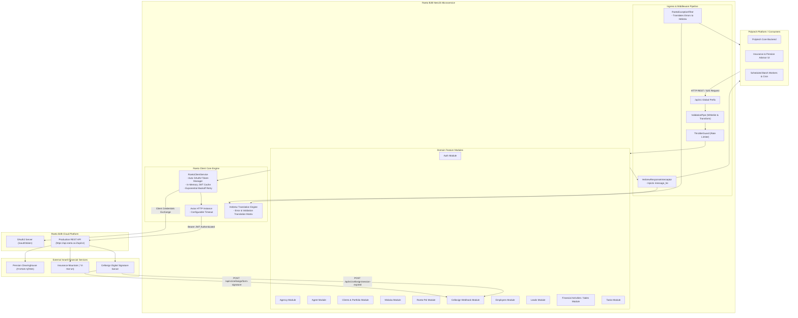
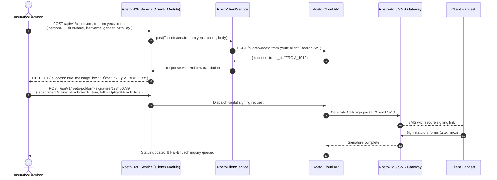
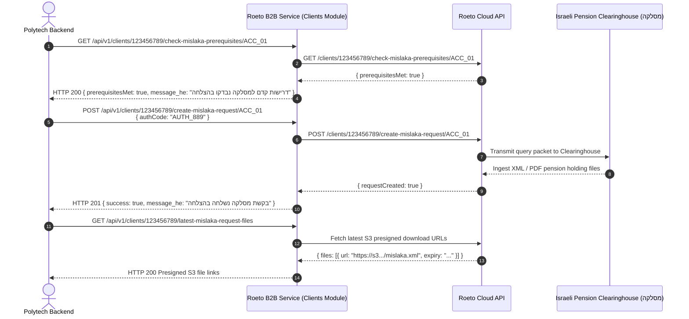
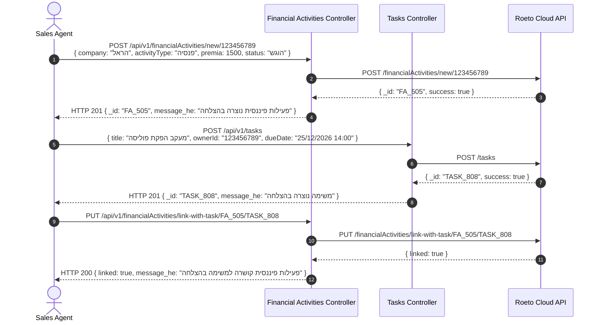

# Architecture Document: Roeto B2B Enterprise Microservice

## 1. Overview & Objectives

**Roeto B2B Enterprise Service** is a dedicated, production-grade NestJS microservice designed to serve as the unified Israeli Insurance, Pension, and Wealth Management CRM gateway for the Polytech platform ecosystem. It integrates the complete [Roeto B2B API](https://api.roeto.co.il/api-docs/) (all 60 operations across 11 distinct functional domains).

### Core Objectives:
1. **Unified Gateway for Pension & Insurance Operations**: Abstracts Israeli insurance, pension clearinghouse (*המסלקה הפנסיונית*), Ministry of Finance insurance mountain (*הר הביטוח*), and digital signature operations into clean, type-safe RESTful APIs.
2. **Automated OAuth2 Token Lifecycle Management**: Handles OAuth2 client credentials exchange (`basicAuth` on `POST /oauth/token`), in-memory JWT token caching, proactive refresh prior to expiration, and automatic `Authorization: Bearer <token>` header injection across all outgoing calls.
3. **Resilient Network Layer**: Encapsulates automatic retry loops with exponential backoff and jitter, defensive timeouts, and comprehensive status code normalization.
4. **Mandatory Hebrew Localization**: Adheres strictly to Polytech Engineering Standards by translating all API error codes, status reports, and validation messages into Hebrew via `HebrewResponseInterceptor` and `RoetoExceptionFilter`.
5. **Full Lifecycle CRM Coverage**: Supports the entire client progression from prospective Lead to Pre-Consulting (*טרום ייעוץ*) to Active Insured Client (*לקוח פעיל*), including digital signature packet dispatches (forms A, B, H) and sales management pipelines.

---

## 2. System Architecture



---

## 3. Detailed Workflows & Sequence Diagrams

### 3.1 Client Onboarding, Pre-Consulting & Digital Signature Flow



### 3.2 Pension Clearinghouse (Mislaka) Data Request Flow



### 3.3 Sales Pipeline & Task Automation Flow



---

## 4. Key Design Decisions

### 4.1 Automated OAuth2 Lifecycle & In-Memory Token Caching
- **Problem**: Roeto uses OAuth2 client credentials (`POST /oauth/token` with Basic Auth). Having callers manually request and pass tokens on every API call introduces massive latency and code duplication.
- **Solution**: `RoetoClientService` automatically manages tokens:
  - Mints tokens using `ROETO_CLIENT_ID` and `ROETO_CLIENT_SECRET`.
  - Caches the Bearer JWT in memory along with its expiration timestamp.
  - Proactively refreshes the token 60 seconds before expiration.
  - Automatically injects the cached token into outgoing requests while still supporting optional caller overrides via `options.token`.

### 4.2 Mandatory Hebrew Localization Layer (AGENTS.md Compliance)
- **Problem**: Polytech Development Guidelines mandate that all API responses, validation errors, and statuses returned by microservices must have a Hebrew translation.
- **Solution**:
  - `HebrewResponseInterceptor`: Automatically intercepts all outgoing controller responses and injects `message_he`.
  - `RoetoExceptionFilter`: Automatically intercepts exceptions (including `class-validator` arrays and `RoetoApiException`), mapping English error text to Hebrew equivalents (`message_he`, `messages_he`, `error_he`).
  - `HEBREW_TRANSLATIONS`: Centralized dictionary covering all insurance, pension, and CRM operations.

### 4.3 Multi-part Form Data & Document Uploads (S3)
- File uploads (such as client documents and Mislaka B1 POA photos/PDFs) support `multipart/form-data` with automatic MIME boundaries and 10MB file limits via `@nestjs/platform-express` `FileInterceptor`.

### 4.4 Throttling & Rate Limit Compliance
- Certain Roeto endpoints (notably `GET /agent/dashboard`) enforce strict rate limits (5 requests per 5 minutes).
- The service integrates `@nestjs/throttler` to enforce sane cluster-wide limits and prevent downstream carrier blocking.

---

## 5. Module & Directory Structure

```text
src/
├── main.ts                                 # Bootstrap, CORS, global prefix api/v1, ValidationPipe
├── app.module.ts                           # Root module importing all 11 domains & global providers
├── app.controller.ts                       # Health check endpoint controller
├── app.service.ts                          # Health check telemetry & status
├── config/
│   ├── config.constants.ts                 # Configuration keys and default values
│   └── roeto.config.ts                     # Dynamic environment configuration loader
├── common/
│   ├── constants/
│   │   └── api.constants.ts                # Centralized URLs, headers, and 59 endpoint paths
│   ├── errors/
│   │   ├── roeto-api.exception.ts          # Custom typed exception preserving HTTP status & Hebrew
│   │   └── roeto-exception.filter.ts       # Global exception filter translating errors to Hebrew
│   ├── i18n/
│   │   ├── hebrew-translations.constants.ts# Hebrew translation dictionary & helper
│   │   └── hebrew-translations.spec.ts     # Translation unit tests
│   └── interceptors/
│       └── hebrew-response.interceptor.ts  # Global response interceptor injecting message_he
├── roeto-client/                           # Central HTTP client & OAuth2 token manager
│   ├── roeto-client.module.ts
│   ├── roeto-client.service.ts             # Axios wrapper, auto OAuth2 token caching, retry engine
│   ├── roeto-client.service.spec.ts
│   └── roeto-client.types.ts               # Request options and token interfaces
├── auth/                                   # Authentication (/oauth/token, /oauth/check-token)
├── agency/                                 # Agents list, users list, client types, client existence
├── agent/                                  # Agent KPI dashboard & wealth difference analytics
├── clients/                                # 22 endpoints: Trom-Yeutz, Active clients, Mislaka B1, S3 uploads
├── mislaka/                                # Pension Clearinghouse accounts & recognized companies
├── roeto-pol/                              # Digital signatures (Forms A, B, H) & Har-Bituach inquiries
├── cellosign/                              # Cellosign signed document & expired session webhooks
├── employers/                              # Directory search for employers (tax IDs, names)
├── leads/                                  # Campaigns, lead creation, search, CSV batch import
├── financial-activities/                   # Sales management, pipeline, premiums, task linking
└── tasks/                                  # CRM tasks, due dates, reminders, call logs, reassignment
```

---

## 6. Complete API Specification Summary (All 60 Operations)

| Domain | Method | Endpoint Path | Description |
| :--- | :--- | :--- | :--- |
| **Health** | `GET` | `/api/v1/health` | Health telemetry, runtime status, and Hebrew health message |
| **Auth** | `POST` | `/api/v1/oauth/token` | Exchange client credentials for signed Roeto JWT |
| **Auth** | `GET` | `/api/v1/oauth/check-token` | Verify active JWT token validity |
| **Agency** | `GET` | `/api/v1/agency/agents-list` | Retrieve licensed marketing agents (*sochnimMeshavkim*) |
| **Agency** | `GET` | `/api/v1/agency/users-list` | Retrieve agency users grouped by role (CRM, tiful, telemeeting) |
| **Agency** | `GET` | `/api/v1/agency/client-types` | Get available client classification labels (*סיווגי לקוח*) |
| **Agency** | `GET` | `/api/v1/agency/clients-by-agent/:meshavekItemId` | Get all clients assigned to a specific marketing agent |
| **Agency** | `GET` | `/api/v1/agency/check-client-existance` | Verify client existence across agency by Israeli ID, phone, or email |
| **Agent** | `GET` | `/api/v1/agent/dashboard` | Rate-limited BI dashboard of wealth, premiums, and discrepancies |
| **Clients** | `GET` | `/api/v1/clients/birthdays` | Upcoming client birthdays within 3-day window |
| **Clients** | `GET` | `/api/v1/clients/search` | Multi-criteria search across clients and policyholders |
| **Clients** | `GET` | `/api/v1/clients/portfolio/:userID` | Full active client portfolio: policies, tasks, sales, logs |
| **Clients** | `POST` | `/api/v1/clients/:userID/notes` | Append timestamped event log / note to client history |
| **Clients** | `GET` | `/api/v1/clients/tromYeutz/portfolio/:userID` | Pre-consulting (*טרום ייעוץ*) prospect portfolio |
| **Clients** | `GET` | `/api/v1/clients/:userID/check-mislaka-prerequisites/:accountId` | Check Mislaka Clearinghouse prerequisites |
| **Clients** | `POST` | `/api/v1/clients/:userID/create-mislaka-request/:accountId` | Submit Mislaka data request for pension holdings |
| **Clients** | `GET` | `/api/v1/clients/:userID/latest-mislaka-request-files` | Retrieve presigned S3 download URLs for Clearinghouse files |
| **Clients** | `POST` | `/api/v1/clients/:userID/create-mislaka-b1-request/:accountId` | Submit Mislaka Power of Attorney (B1 Form) with ID & PDF |
| **Clients** | `POST` | `/api/v1/clients/create-trom-yeutz-client` | Register new pre-consulting (*טרום ייעוץ*) prospect |
| **Clients** | `POST` | `/api/v1/clients/create-active-client` | Register new active insured client |
| **Clients** | `PUT` | `/api/v1/clients/convert-trom-to-active/:userID` | Convert trom-yeutz prospect to active client (copying files & logs) |
| **Clients** | `POST` | `/api/v1/clients/assign-agent` | Assign marketing agent to client |
| **Clients** | `PUT` | `/api/v1/clients/:userID/goremMetapel` | Designate back-office case handler (*גורם מטפל*) |
| **Clients** | `POST` | `/api/v1/clients/:userID/update-details` | Update active client demographics and contact info |
| **Clients** | `POST` | `/api/v1/clients/:userID/change-active-client-type` | Update client classification label (*סיווג לקוח*) |
| **Clients** | `POST` | `/api/v1/clients/:userID/update-trom-yeutz-details` | Update trom-yeutz prospect details |
| **Clients** | `POST` | `/api/v1/clients/:userID/set-id-issue-date` | Set ID issue date (*תאריך הנפקת תעודת זהות*) |
| **Clients** | `POST` | `/api/v1/clients/assign-employer` | Associate employer record (*מעסיק נוכחי*) with active client |
| **Clients** | `GET` | `/api/v1/clients/by-employer/:employerId` | Retrieve all employees/clients under an employer |
| **Clients** | `POST` | `/api/v1/clients/:userID/upload-file-tromYeutz-client` | Upload document to S3 for trom-yeutz client profile |
| **Clients** | `POST` | `/api/v1/clients/:userID/upload-file-active-client` | Upload document to S3 for active client profile |
| **Mislaka** | `GET` | `/api/v1/mislaka/connection` | Retrieve active Clearinghouse connection accounts |
| **Mislaka** | `GET` | `/api/v1/mislaka/companies-list` | Directory of recognized pension/insurance carriers with Het-Pey |
| **Roeto-Pol** | `GET` | `/api/v1/roeto-pol/accounts` | Retrieve available Roeto-Pol signing accounts |
| **Roeto-Pol** | `POST` | `/api/v1/roeto-pol/form-signature/:userID` | Dispatch remote digital signature packet (Forms A, B, H) via SMS |
| **Roeto-Pol** | `POST` | `/api/v1/roeto-pol/har-bituach/:userID` | Submit Ministry of Finance Insurance Mountain (*הר הביטוח*) query |
| **Cellosign** | `POST` | `/api/v1/cellosign/form-signature` | Ingest signed form webhook from Cellosign (stores PDF to S3) |
| **Cellosign** | `POST` | `/api/v1/cellosign/session-expired` | Ingest signature session expired webhook from Cellosign |
| **Employers** | `GET` | `/api/v1/employers` | Search employers by business name, tax ID (*ח"פ*), or ObjectId |
| **Leads** | `GET` | `/api/v1/leads/campaigns` | List active marketing campaigns |
| **Leads** | `POST` | `/api/v1/leads/lead` | Enroll prospective lead into campaign |
| **Leads** | `PUT` | `/api/v1/leads/lead/:leadId` | Update lead contact info, status, or follow-up notes |
| **Leads** | `GET` | `/api/v1/leads/leads/search` | Search leads across multiple criteria |
| **Leads** | `POST` | `/api/v1/leads/import` | Bulk import leads from CSV upload |
| **Sales** | `GET` | `/api/v1/financialActivities/resources` | Lookup dropdowns: users, statuses, sale titles, carriers |
| **Sales** | `GET` | `/api/v1/financialActivities/search` | Search sales records by company, activity type, status, agent |
| **Sales** | `GET` | `/api/v1/financialActivities/fetch` | Fetch sales activities with execution/cancellation date intervals |
| **Sales** | `POST` | `/api/v1/financialActivities/new/:userID` | Log new sales activity / policy production record |
| **Sales** | `PUT` | `/api/v1/financialActivities/update/:faId` | Update financial values, transfer sums, premiums, or dates |
| **Sales** | `PUT` | `/api/v1/financialActivities/change-status/:faId` | Update workflow status (e.g. from "הוגש" to "הושלם") |
| **Sales** | `PUT` | `/api/v1/financialActivities/link-with-task/:faId/:taskId` | Create bidirectional link between sales activity and CRM task |
| **Tasks** | `GET` | `/api/v1/tasks` | Get CRM tasks with optional client or title filters |
| **Tasks** | `POST` | `/api/v1/tasks` | Provision new task with due date, reminder, tags, assignee |
| **Tasks** | `GET` | `/api/v1/tasks/resources` | Lookup resources for task creation (clients, employers, users) |
| **Tasks** | `PUT` | `/api/v1/tasks/:taskId/toggle-complete` | Toggle task completion status |
| **Tasks** | `PUT` | `/api/v1/tasks/:taskId/description` | Update detailed task description |
| **Tasks** | `PUT` | `/api/v1/tasks/:taskId/action` | Append call log entry or comment to task history |
| **Tasks** | `PUT` | `/api/v1/tasks/:taskId/due-date` | Update scheduled task due date |
| **Tasks** | `PUT` | `/api/v1/tasks/:taskId/toggle-reminder` | Enable or disable reminder notifications |
| **Tasks** | `GET` | `/api/v1/tasks/by-user/:userId` | Get uncompleted tasks assigned to a specific user |
| **Tasks** | `POST` | `/api/v1/tasks/reassign-tasks/:userId` | Bulk reassign multiple tasks simultaneously to a user |

---

## 7. Standards & Quality Compliance (Per AGENTS.md)

1. **Package Manager**: All dependencies strictly managed via `pnpm`.
2. **Type Safety**: 100% typed with TypeScript interfaces and DTOs; zero `any` usage. Verified via `pnpm run typecheck`.
3. **No Magic Strings or Numbers**: All endpoints, headers, and translations reside in centralized `constants/` files.
4. **Validation**: Exclusively `class-validator` and `class-transformer` (no Zod or Joi).
5. **Hebrew Responses**: Every API response, validation failure, and error code is translated and returned in Hebrew via `HebrewResponseInterceptor` and `RoetoExceptionFilter`.
6. **Testing Suite**:
   - Unit Testing: Jest (`pnpm test`) covering services, retry handling, and translations.
   - E2E Testing: Playwright (`pnpm run test:playwright`) and Jest/Supertest (`pnpm run test:e2e`).
7. **Linting**: Oxlint automated checks (`pnpm run lint` — 0 warnings policy).
8. **Secrets & Environment Confidentiality**: Strict zero-inspection policy on secret files.
